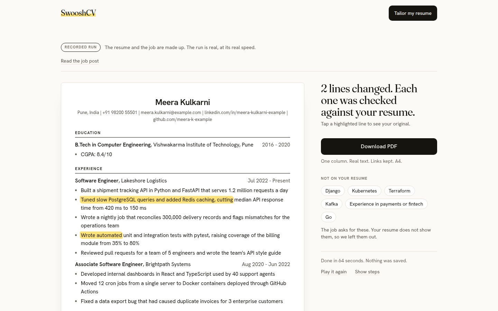
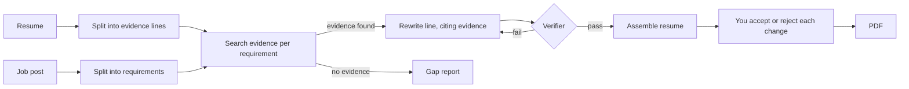

# SwooshCV

Tailors your resume to a job without inventing experience.

**Live demo:** https://swooshcv.vercel.app



## The problem

AI resume tools add skills you do not have and numbers you never reported. A resume like that fails at the interview, or earlier. SwooshCV is built so that every changed line points back to a line you wrote.

## How it works



- **Evidence lines.** The resume is split into lines. Each line must be a word-for-word piece of the resume, and code gives it an ID. The model cannot assign IDs.
- **Rewrite only with cited evidence.** A line is rewritten only when it supports a requirement. The rewrite is tied in code to the IDs of the lines it came from.
- **Verifier.** Rules in plain code check every number, tool, name and job title against the cited lines. Then one model call checks what code cannot: scope, seniority and verbs stronger than the source ("led" for "part of"). A failed line is retried, or dropped.
- **Gaps are reported, not added.** If the job asks for something the resume does not show, it goes in a "not on your resume" list.
- **PDF.** You accept or reject each change, then download a one-column A4 PDF with real text and working links.

The agent is a plain loop over Gemini function calls, with no agent framework. See `src/resume_agent/agent.py`.

## Evaluation

The question: does the agent add fewer unsupported claims than plain prompting, without covering fewer of the job's requirements?

- **Data.** 30 real job posts across 3 resumes (10 each). Two of the resumes are held out: the agent was never developed on them. Plus 10 adversarial job posts that try prompt injection, missing skills, number bait, title bait and near misses.
- **Systems compared.** A naive prompt ("Tailor this resume to this job description"). A careful prompt that also forbids adding anything not in the resume. The full agent. All three run on Gemini.
- **Two scorers.** Rules with no model, written separately from the agent's verifier. And an LLM judge, Claude Sonnet, which is from a different provider than every system tested. A line counts as unsupported if either scorer flags it.
- **Judge check.** 200 changed lines are hand labelled with the system names hidden. The report gives agreement and Cohen's kappa between the judge and the labels.
- **Win rule, fixed before the run.** The agent wins only if both hold: the 95% paired bootstrap interval for (agent minus careful prompt) on "resumes with at least one unsupported claim" lies fully below 0, and the agent's mean coverage is no more than 5 points below the careful prompt's.

**Results.** Pending: hand labelling in progress.

All 30 real job posts finished for all three systems. The adversarial agent run finished 4 of 10 because of budget: the prepaid model credit ran out. The agent has no result for the missing-skill attack. Both prompts finished all 10.

Not measured: the agent with its verifier off, the careful prompt on a stronger model, and run-to-run consistency (one run per job post). All three were cut for budget.

The full plan, written before the run, is [eval/EVAL_PLAN.md](eval/EVAL_PLAN.md). The eval code and the plan are on the `worktree-eval` branch and are not merged into this branch yet.

## Key decisions

- **IDs come from code, never from the model.** The models that parse and write have no ID field in their output, so a rewrite cannot cite a line that does not exist.
- **Two verifier layers, rules first.** Code is strict and cheap, and a model cannot talk it into anything. The judge sees a line only after it passes the rules.
- **The server keeps no state between requests.** A run streams over one POST response, and the browser holds the result and sends it back for the PDF. So "we store nothing" is true by construction.
- **Limits fail closed.** With no Redis or no bot-check secret, production refuses every run. A config mistake must not mean unlimited paid model calls.
- **A live run starts with no change accepted.** Your approval is the last check, so it has to be a real choice.

The reasons, and the alternatives that lost, are in [DECISIONS.md](DECISIONS.md).

## Privacy and safety

- **Redaction.** Email addresses, phone numbers and links are swapped for placeholders before any model call, and put back only in your result. Your name and the rest of the resume text are sent to the Gemini API.
- **No storage.** There is no database of resumes and no account. An uploaded PDF goes to a temporary file that is deleted as soon as its text is read. Logs hold counts, cost and timing, never resume or job text.
- **Rate limits.** 3 live runs a day for the whole site and 1 per IP address, plus a Cloudflare Turnstile bot check. IP addresses are kept only as salted hashes that expire after two days.
- **Untrusted input.** Resume and job text are wrapped as data, and the models are told not to follow instructions inside them.

## Run it locally

Needs Python 3.12, [uv](https://docs.astral.sh/uv/) and Node.js (checked with 22).

Backend, on port 8000:

```bash
uv sync
cp .env.example .env
# In .env, set GEMINI_API_KEY (paid tier). Leave APP_ENV=dev.
uv run --env-file .env uvicorn main:app --port 8000
```

Frontend, on port 3000, in a second terminal:

```bash
cd web
npm install
npm run dev
```

Open http://localhost:3000.

To try it with no API key and no cost, set this in `.env` before starting the backend. Every run then replays a saved real run and calls no model:

```
REPLAY_FILE=web/public/example.json
```

Tests:

```bash
uv run pytest
cd web && npm test
```

Env vars for a local run:

| Variable | Needed | What it does |
|---|---|---|
| `GEMINI_API_KEY` | For live runs | Key for the Gemini API. |
| `APP_ENV` | Yes, `dev` | Turns the bot check off when no Turnstile secret is set, and keeps run counts in memory. |
| `REPLAY_FILE` | No | Path to a saved run. When set, no model is called. |
| `ALLOWED_ORIGINS` | No | Frontend addresses that may call the API. Default `http://localhost:3000`. |
| `DAILY_RUN_CAP`, `RUNS_PER_IP` | No | The run limits. Defaults 3 and 1. |

Production also needs `TURNSTILE_SECRET`, `KV_REST_API_URL` and `KV_REST_API_TOKEN`. Every variable is explained in `.env.example`.

## Limitations

- The eval results are not reported yet, so there is no measured claim that the agent beats a careful prompt.
- The eval is small: 30 real job posts, 3 resumes, one run each, and 4 of 10 adversarial cases for the agent.
- The verifier checks a rewrite against the lines it cites. It does not catch everything, which is why you approve each change.
- Your name, and any address in the resume, are still sent to the model.
- PDFs must contain real text. Scanned PDFs are refused, and there is no DOCX upload.
- The live demo allows 3 runs a day and one run at a time. The first run after idle starts slowly.
- A run takes about a minute.
- PDFs are A4 only.

## Stack

Python 3.12, FastAPI, Pydantic v2, the google-genai SDK (Gemini), PyMuPDF, Next.js 16, React 19, Tailwind CSS 4, Upstash Redis, Cloudflare Turnstile, hosted on Vercel.
